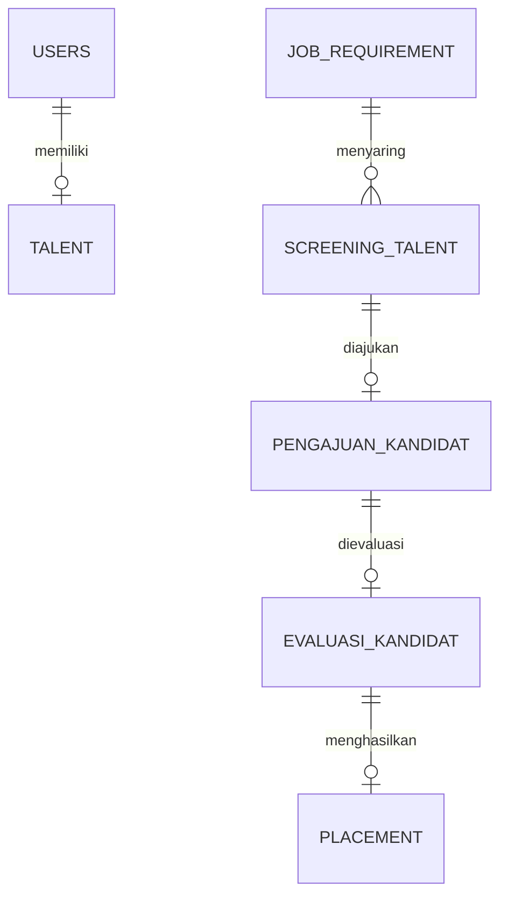

## 📑 Daftar Isi
- [Fitur](#-fitur)
- [Tech Stack](#-tech-stack)
- [Tampilan](#-tampilan)
- [Desain Sistem](#-desain-sistem)
- [Instalasi](#-instalasi)
- [Tim](#-tim)

## ✨ Fitur

| Role | Fitur Utama |
|---|---|
| **Talent** | Profil & kompetensi, generate CV, jadwal interview, cuti, shift |
| **HR Client** | Buat job requirement, evaluasi kandidat, approval cuti, laporan keluhan |
| **Account Manager** | Kelola kebutuhan klien, ajukan kandidat, jadwal interview, dokumen |
| **Talent Support** | Talent pool, rekomendasi kandidat, screening, placement |
| **Manager** | Dashboard monitoring, progres & SLA, monitoring talent |

## 🛠 Tech Stack

| Layer | Teknologi |
|---|---|
| Backend | Laravel (REST API), Sanctum, spatie/laravel-permission |
| Frontend | React (Vite), Tailwind CSS, shadcn/ui |
| Database | MySQL |
| Lainnya | laravel-dompdf, Laravel Mail & Scheduler |

## 🖼 Tampilan
<!-- Seret screenshot / GIF ke sini -->

## 🧩 Desain Sistem

<details>
<summary><b>ERD</b> (klik untuk membuka)</summary>


</details>

## ⚙️ Instalasi

```bash
git clone https://github.com/USERNAME/REPO.git
cd REPO/backend
composer install
cp .env.example .env
php artisan key:generate
php artisan migrate --seed
php artisan serve

cd ../frontend
npm install
npm run dev
```

## 👥 Tim

| Nama | Peran |
|---|---|
| Veronica Benita Sanjaya | Project Manager |
| Flora Syifa  | Backend Developer |
| Randy Abraham Pythagoras Hutasoit | Frontend Developer |
| Junhaikal Syahwana  | UI/UX Designer |

<a href="https://github.com/USERNAME/REPO/graphs/contributors">
  
</a>
