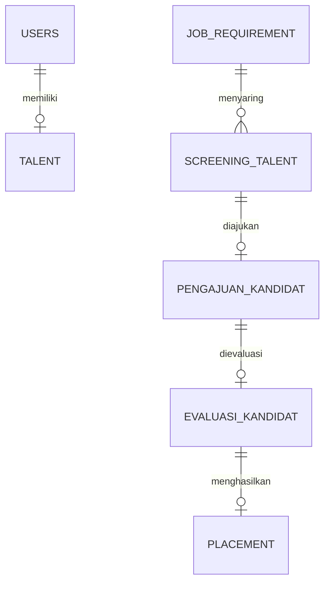

## 📑 Daftar Isi
- [Fitur](#-fitur)
- [Tech Stack](#-tech-stack)
- [Tampilan](#-tampilan)
- [Desain Sistem](#-desain-sistem)
- [Instalasi](#-instalasi)
- [Tim](#-tim)

## ✨ Fitur

| Role | Fitur Utama |
|---|---|
| **Talent** | Profil & kompetensi, generate CV, jadwal interview, cuti, shift |
| **HR Client** | Buat job requirement, evaluasi kandidat, approval cuti, laporan keluhan |
| **Account Manager** | Kelola kebutuhan klien, ajukan kandidat, jadwal interview, dokumen |
| **Talent Support** | Talent pool, rekomendasi kandidat, screening, placement |
| **Manager** | Dashboard monitoring, progres & SLA, monitoring talent |

## 🛠 Tech Stack

| Layer | Teknologi |
|---|---|
| Backend | Laravel 12 (REST API), Sanctum (token), otorisasi lewat `users.role` + Policies |
| Frontend | React (Vite), Tailwind CSS, React Router |
| Database | MySQL 8 |
| Lainnya | laravel-dompdf, Laravel Mail & Scheduler, Pest (test), Scribe (dokumentasi API) |

## 🖼 Tampilan
<!-- Seret screenshot / GIF ke sini -->

## 🧩 Desain Sistem

<details>
<summary><b>ERD</b> (klik untuk membuka)</summary>


</details>

## ⚙️ Instalasi

Repo ini berisi **backend** (Laravel 12 REST API, prefix `/api/v1`). Frontend ada di repo terpisah: [Capstone_Frontend_Kelompok14](https://github.com/Randy-ano/Capstone_Frontend_Kelompok14).
Panduan lengkap (software, Laragon, masalah umum, aturan tim): **[SETUP.md](SETUP.md)**.

Prasyarat: PHP ≥ 8.2, Composer 2, MySQL 8 (Laragon) dengan database `intellisys_talent_hub` (utf8mb4).

```bash
git clone https://github.com/Randy-ano/Capstone_Backend_Kelompok14.git
cd Capstone_Backend_Kelompok14
composer install
copy .env.example .env
php artisan key:generate
php artisan migrate:fresh --seed   # skema + data demo (bisa diulang kapan saja untuk reset)
php artisan serve                  # http://localhost:8000
```

Cek: http://localhost:8000/api/v1/health → `{"status":"ok"}`. Frontend dibuka di http://localhost:5173 (CORS hanya mengizinkan origin itu).

### Akun demo

Password semua akun: **`password`**.

| Email | Role |
|---|---|
| manager@intellisys.test | Manager |
| am@intellisys.test | Account Manager |
| ts@intellisys.test | Talent Support |
| hr@intellisys.test | HR Client (PT Maju Jaya) |
| talent@intellisys.test | Talent (Budi Santoso, sudah placement aktif) |

Tambahan: `talent01@` s.d. `talent19@intellisys.test` (password sama).

### Queue & scheduler

Notifikasi email (pengingat R31) dikirim lewat antrean `database`; mail driver default `log` (email ditulis ke `storage/logs/laravel.log`). Jalankan di terminal terpisah selain `php artisan serve`:

```bash
php artisan queue:work        # memproses antrean email notifikasi
php artisan schedule:work     # menjalankan jadwal: notifikasi:pengingat setiap hari 07:00 WIB
```

Pengingat juga bisa dijalankan manual saat demo/pengujian: `php artisan notifikasi:pengingat` (aman diulang; pesan yang sama tidak dikirim dua kali di hari yang sama).
Di server produksi cukup satu cron: `* * * * * php /path/ke/repo/artisan schedule:run >> /dev/null 2>&1`, plus `queue:work` yang dijaga supervisor.

### Dokumentasi API

Dokumentasi dibuat dengan [Scribe](https://scribe.knuckles.wtf) (dependensi dev) dan **tidak di-commit**, jadi buat ulang setelah clone atau setelah endpoint berubah:

```bash
php artisan migrate:fresh --seed   # contoh respons diambil dari data demo
php artisan scribe:generate
```

| Hasil | Lokasi |
|---|---|
| Dokumentasi HTML | http://localhost:8000/docs (saat `php artisan serve` menyala) |
| OpenAPI 3 | http://localhost:8000/docs.openapi atau `storage/app/private/scribe/openapi.yaml` |
| Koleksi Postman | http://localhost:8000/docs.postman atau `storage/app/private/scribe/collection.json` |

Contoh respons berasal dari panggilan asli ke endpoint (memakai akun demo sesuai role, di dalam transaksi yang di-rollback sehingga data tidak berubah). Endpoint unduh/unggah file memakai contoh tertulis. Beberapa endpoint aksi menampilkan contoh 422 karena data demo sudah melewati tahap tersebut; pesan itu adalah aturan bisnis yang sebenarnya.

Autentikasi: `POST /api/v1/auth/login` → pakai `token` sebagai header `Authorization: Bearer {token}`.

### Test

```bash
php artisan test   # Pest, SQLite in-memory (tidak menyentuh data MySQL)
```

Spesifikasi backend: [BACKEND_SPEC.md](BACKEND_SPEC.md) · keputusan di luar spec: [DECISIONS.md](DECISIONS.md).

## 👥 Tim

| Nama | Peran |
|---|---|
| Veronica Benita Sanjaya | Project Manager |
| Flora Syifa  | Backend Developer |
| Randy Abraham Pythagoras Hutasoit | Frontend Developer |
| Junhaikal Syahwana  | UI/UX Designer |

<a href="https://github.com/Randy-ano/Capstone_Backend_Kelompok14/graphs/contributors">
  
</a>
